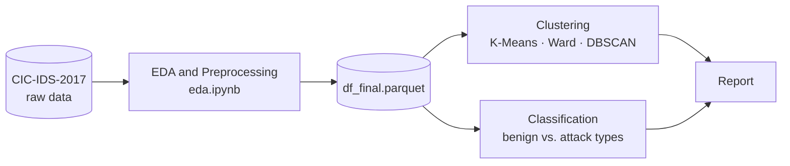

# 🛡️ Network Traffic Analysis and Cyberattack Detection using Data Mining Techniques


> This project explores the **CIC-IDS-2017** dataset through Exploratory Data Analysis (EDA), Clustering (K-Means, Hierarchical, DBSCAN), and Classification models to identify malicious network behavior.

## 📖 About the Project

This repository contains the implementation of a Data Mining project focused on analyzing network traffic behavior and detecting cyberattacks. Using the CIC-IDS-2017 dataset, we apply a range of Machine Learning and Data Mining techniques, from Exploratory Data Analysis (EDA) to Clustering and Classification, to identify anomalies and effectively classify malicious network activity.

The project was developed as part of the **"Data Mining and Learning Algorithms"** course at the **University of Patras** (Department of Computer Engineering and Informatics, CEID) during the Spring Semester of 2025–2026.

## 📊 Dataset

The project uses the **Network Intrusion Dataset (CIC-IDS-2017)**, created by the [Canadian Institute for Cybersecurity](https://www.unb.ca/cic/datasets/ids-2017.html) at the University of New Brunswick. It contains realistic network traffic captured over five days (July 3–7, 2017), with flow-level features extracted using CICFlowMeter.

Alongside **benign** traffic, the dataset includes a wide range of common attacks: Brute Force (FTP-Patator, SSH-Patator), DoS (Hulk, GoldenEye, slowloris, Slowhttptest), DDoS, Web attacks (Brute Force, XSS, SQL Injection), PortScan, Botnet, Infiltration, and Heartbleed. This makes it a realistic testbed for cyberattack detection mechanisms.

The raw CSV files can be downloaded from the [official page](https://www.unb.ca/cic/datasets/ids-2017.html). This repository contains only the processed dataset(s) generated by the EDA notebook, stored in [`data/`](data/).

## 📂 Project Structure

```text
Data-Mining-ML-Project/
├── README.md
├── data/                           # Processed datasets (.parquet) after EDA & preprocessing
│   └── *.parquet
├── notebooks/                      # Jupyter notebooks
│   ├── eda.ipynb                   # Exploratory Data Analysis & preprocessing
│   ├── clustering.ipynb            # Unsupervised learning
│   └── classification.ipynb        # Supervised learning
└── Αναφορά Εξόρυξη Δεδομένων.pdf   # Technical report (in Greek)
```

## 🔬 Workflow



| # | Stage | Notebook | Description |
|---|-------|----------|-------------|
| 1 | **EDA & Preprocessing** | [`eda.ipynb`](notebooks/eda.ipynb) | Data cleaning, handling of missing values, and feature engineering. Exports the ready-to-use dataset (`df_final.parquet`). |
| 2 | **Clustering** (unsupervised) | [`clustering.ipynb`](notebooks/clustering.ipynb) | Implementation and evaluation of **K-Means**, **Hierarchical (Ward)**, and **DBSCAN** to discover hidden patterns and group similar network behaviors *without* using the target labels. |
| 3 | **Classification** (supervised) | [`classification.ipynb`](notebooks/classification.ipynb) | Training and evaluation of machine learning models to classify network traffic as benign or into specific attack types. |

## 🛠️ Technologies & Libraries

| Category | Tools |
|----------|-------|
| Language | Python 3 |
| Data manipulation | Pandas, NumPy, PyArrow (Parquet support) |
| Machine learning | Scikit-Learn |
| Data visualization | Matplotlib, Seaborn |
| Environment | Jupyter Notebook |

## 🚀 How to Run

### 1. Clone the repository

```bash
git clone https://github.com/<your-username>/Data-Mining-ML-Project.git
cd Data-Mining-ML-Project
```

### 2. Set up the environment

Python 3 and `pip` are required. Using a virtual environment is recommended:

```bash
python -m venv .venv
source .venv/bin/activate        # On Windows: .venv\Scripts\activate
pip install pandas numpy pyarrow scikit-learn matplotlib seaborn jupyter
```

### 3. Launch Jupyter and run the notebooks

```bash
jupyter notebook
```

Open the notebooks in the `notebooks/` folder and run them in this order:

1. `eda.ipynb`: preprocessing (generates the processed `.parquet` dataset)
2. `clustering.ipynb`
3. `classification.ipynb`

> 💡 **Tip:** The processed dataset is already available in `data/`, so you can go straight to the clustering and classification notebooks. To reproduce the preprocessing from scratch, download the raw CIC-IDS-2017 CSV files from the [official page](https://www.unb.ca/cic/datasets/ids-2017.html) and update the data path at the top of `eda.ipynb`. Note that loading the full raw dataset with Pandas can require several GB of RAM.

## 📄 Report & Results

The full technical report, **[Αναφορά Εξόρυξη Δεδομένων.pdf](Αναφορά%20Εξόρυξη%20Δεδομένων.pdf)** (written in Greek), covers the methodology, experimental setup, hyperparameter tuning, and a detailed interpretation of the results.

<!--
OPTIONAL: summarize your key findings here, then delete this comment wrapper.

| Task           | Method              | Key outcome (e.g. best k / silhouette score / F1) |
|----------------|---------------------|----------------------------------------------------|
| Clustering     | K-Means             | …                                                  |
| Clustering     | Hierarchical (Ward) | …                                                  |
| Clustering     | DBSCAN              | …                                                  |
| Classification | …                   | …                                                  |
-->

## 👥 Authors

- **Your Name** — [@your-username](https://github.com/GiannisKotsalos)
- **Teammate Name** — [@teammate-username](https://github.com/andreasKaramalikis)
- )

## 📚 References

- I. Sharafaldin, A. H. Lashkari, and A. A. Ghorbani, *"Toward Generating a New Intrusion Detection Dataset and Intrusion Traffic Characterization,"* in Proc. 4th International Conference on Information Systems Security and Privacy (ICISSP), 2018, pp. 108–116.
- [CIC-IDS-2017 dataset page](https://www.unb.ca/cic/datasets/ids-2017.html), Canadian Institute for Cybersecurity, University of New Brunswick.

<details>
<summary>BibTeX</summary>

```bibtex
@inproceedings{sharafaldin2018toward,
  title     = {Toward Generating a New Intrusion Detection Dataset and Intrusion Traffic Characterization},
  author    = {Sharafaldin, Iman and Lashkari, Arash Habibi and Ghorbani, Ali A.},
  booktitle = {Proceedings of the 4th International Conference on Information Systems Security and Privacy (ICISSP)},
  pages     = {108--116},
  year      = {2018}
}
```

</details>

## 📝 License & Usage

This project was created for educational purposes as part of a university course. If you reuse any part of it, please credit the authors and the creators of the CIC-IDS-2017 dataset.

