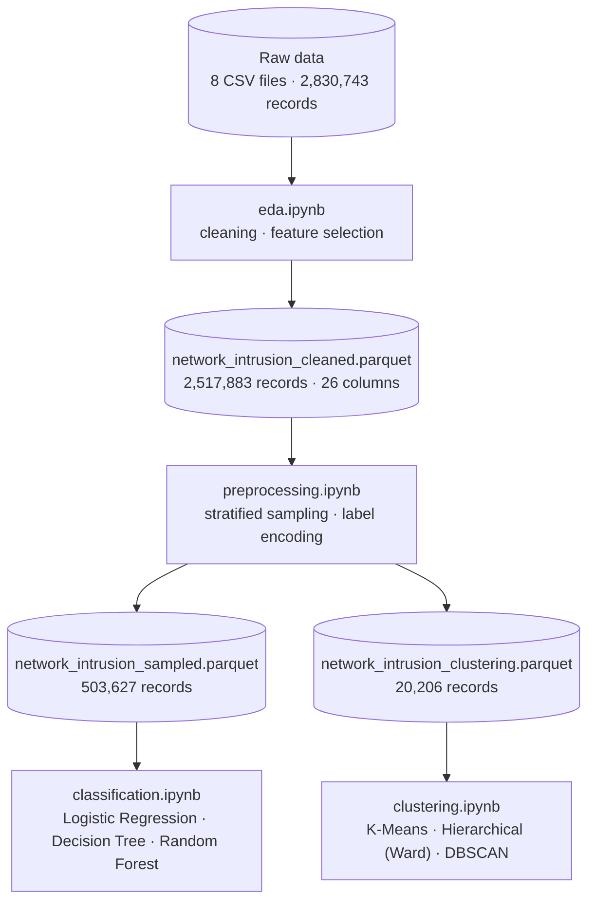

# 🛡️ Network Traffic Analysis and Cyberattack Detection using Data Mining Techniques


> This project explores the **CIC-IDS-2017** dataset through Exploratory Data Analysis (EDA), Clustering (K-Means, Hierarchical, DBSCAN), and Classification models to identify malicious network behavior.

## 📖 About the Project

This repository contains the implementation of a Data Mining project focused on analyzing network traffic behavior and detecting cyberattacks. Using the **CIC-IDS-2017** dataset, we apply Machine Learning and Data Mining techniques, from Exploratory Data Analysis (EDA) to Clustering and Classification, to identify anomalies and classify malicious network activity.

The project was developed as part of the **"Data Mining & Machine Learning"** course at the **University of Patras** (Department of Computer Engineering and Informatics, CEID) during the Spring Semester of 2025–2026.

**At a glance**

-  **EDA & cleaning:** 2,830,743 raw records and 79 columns reduced to 2,517,883 clean records and 26 columns.
-  **Classification:** Logistic Regression, Decision Tree and Random Forest on 15 traffic classes. Random Forest was judged the most balanced and stable model.
-  **Clustering:** K-Means, Hierarchical (Ward) and DBSCAN compared against the true labels. K-Means achieved the highest ARI and NMI.

## 📊 Dataset

The project uses the **Network Intrusion Dataset (CIC-IDS-2017)** from Kaggle ([`chethuhn/network-intrusion-dataset`](https://www.kaggle.com/datasets/chethuhn/network-intrusion-dataset)), based on the CIC-IDS-2017 dataset created by the [Canadian Institute for Cybersecurity](https://www.unb.ca/cic/datasets/ids-2017.html) (University of New Brunswick). It contains realistic network traffic captured over five days (July 3–7, 2017), with flow-level features extracted using CICFlowMeter.

Alongside **benign** traffic, the dataset includes a wide range of common attacks: Brute Force (FTP-Patator, SSH-Patator), DoS (Hulk, GoldenEye, slowloris, Slowhttptest), DDoS, Web attacks (Brute Force, XSS, SQL Injection), PortScan, Botnet, Infiltration, and Heartbleed.

The data is distributed as 8 CSV files, merged into a single table of **2,830,743 records and 79 columns**. After cleaning, **2,517,883 records** remain across **15 classes** (benign + 14 attack types). The classes are **highly imbalanced**: `BENIGN` makes up 83.1% of the records, while `Heartbleed`, `Web Attack – SQL Injection` and `Infiltration` have only 7, 21 and 35 records.

<details>
<summary>Class distribution after cleaning</summary>

| Class | Records |
|-------|--------:|
| BENIGN | 2,092,335 |
| DoS Hulk | 172,688 |
| DDoS | 127,995 |
| PortScan | 90,694 |
| DoS GoldenEye | 10,281 |
| FTP-Patator | 5,927 |
| DoS slowloris | 5,385 |
| DoS Slowhttptest | 5,228 |
| SSH-Patator | 3,217 |
| Bot | 1,948 |
| Web Attack – Brute Force | 1,470 |
| Web Attack – XSS | 652 |
| Infiltration | 35 |
| Web Attack – SQL Injection | 21 |
| Heartbleed | 7 |

</details>

## 📂 Project Structure

```text
Data-Mining-ML-Project/
├── README.md
├── data/                           # Processed datasets (.parquet) produced by EDA & preprocessing
│   └── *.parquet
├── notebooks/
│   ├── eda.ipynb                   # EDA, data cleaning & feature selection
│   ├── preprocessing.ipynb         # Stratified sampling & label encoding
│   ├── classification.ipynb        # Logistic Regression, Decision Tree, Random Forest
│   └── clustering.ipynb            # K-Means, Hierarchical (Ward), DBSCAN
└── Αναφορά Εξόρυξη Δεδομένων.pdf   # Technical report (in Greek)
```

### Data files

| File | Records | Description |
|------|--------:|-------------|
| `network_intrusion_cleaned.parquet` | 2,517,883 | Full cleaned dataset after EDA (26 columns) |
| `network_intrusion_sampled.parquet` | 503,627 | 20% stratified sample for classification, with numeric labels |
| `network_intrusion_clustering.parquet` | 20,206 | 4% sample for clustering (25 features + `Label`) |
| `label_mapping.json` | – | Mapping from class names to numeric codes, used to decode model results |

## 🔬 Methodology



### 1. EDA & data cleaning (`eda.ipynb`)

The eight CSV files are merged, cleaned and reduced to the most informative features. The result is exported as `network_intrusion_cleaned.parquet`.

<details>
<summary>Step-by-step summary</summary>

| Step | Description | Effect |
|------|-------------|--------|
| Load & merge | 8 CSV files concatenated with `pd.concat()`, column names stripped | 2,830,743 records × 79 columns |
| Cleaning | `±Inf` replaced with `NaN`, rows with missing values and exact duplicates dropped, invalid negative values removed (except `Init_Win_bytes_forward`, `Init_Win_bytes_backward` and `min_seg_size_forward`, where −1 is valid for UDP flows) | 2,517,883 records |
| Correlation filter | Pearson correlation with a 0.90 threshold; the first feature of each highly correlated group is kept | −34 features → 45 columns |
| Binary flags | Cross-tabulation against `Label`; dropped `Fwd URG Flags` and `RST Flag Count`, kept `FIN Flag Count`, `URG Flag Count` and `Fwd PSH Flags` | −2 columns |
| Zero variance | `VarianceThreshold` removes constant columns | −8 columns |
| Feature-vs-label box plots | Manually dropped 9 features with heavily overlapping IQRs or near-identical medians across classes: `Fwd Packet Length Min`, `Bwd Packet Length Min`, `Flow IAT Min`, `PSH Flag Count`, `ACK Flag Count`, `Down/Up Ratio`, `min_seg_size_forward`, `Active Std`, `Min Packet Length` | −9 columns |
| **Final** | Exported as `network_intrusion_cleaned.parquet` | **2,517,883 records × 26 columns** |

</details>

### 2. Preprocessing (`preprocessing.ipynb`)

- **Stratified sampling:** 20% for classification (503,627 records) and 4% for clustering (20,206 records). The very small classes (`Heartbleed`, `Web Attack – SQL Injection`, `Infiltration`) are kept in full so no rare attack is lost; the other classes keep their original proportions.
- **Label encoding:** class names are encoded with scikit-learn's `LabelEncoder`, and the mapping is saved to `label_mapping.json`.

### 3. Classification (`classification.ipynb`)

- Stratified train/validation/test split (`stratify=y`, `random_state=42`).
- `StandardScaler` fitted on the training data only, then applied to the validation and test sets.
- Class imbalance handled with `class_weight='balanced'` for the models that support it.
- Hyperparameters tuned with `GridSearchCV` + `StratifiedKFold`:

| Model | Tuned hyperparameters |
|-------|-----------------------|
| Logistic Regression (baseline) | `C`, `solver`, `penalty` |
| Decision Tree | `max_depth`, `min_samples_split`, `min_samples_leaf`, `criterion` |
| Random Forest | `n_estimators`, `max_depth`, `min_samples_split`, `min_samples_leaf` |

- Each model is evaluated in two scenarios: a classic train/validation/test split and 5-fold cross-validation. Metrics: Accuracy, Precision, Recall and F1-score, plus confusion matrices and per-class classification reports.

### 4. Clustering (`clustering.ipynb`)

The `Label` column is removed from the features (unsupervised setting) and kept only for evaluation. Features are standardized with `StandardScaler`.

- **K-Means:** k = 2–11 evaluated with the Elbow method, Silhouette Score and Davies-Bouldin Index. The automatic search picked k = 2 (one cluster holding almost every sample), which was not informative, so **k = 6** was chosen manually.
- **Hierarchical:** four linkage methods (`ward`, `complete`, `average`, `single`) scored with Silhouette, Davies-Bouldin and the size of the smallest cluster (clusters under 5% of the data count as degenerate). The automatic choice (`single`, k = 2) was replaced by **Ward linkage**, which gives a more meaningful separation.
- **DBSCAN:** `eps` estimated with a k-distance graph (k = 4), then a grid search over `eps` ∈ {0.5, 0.8, 1.0, 1.3, 1.5, 2.0, 2.5} and `min_samples` ∈ {5, 10, 15, 20, 50, 100}, maximizing the Silhouette Score. Best: **eps = 1, min_samples = 50**.
- **Evaluation:** internal metrics (Silhouette, Davies-Bouldin), external comparison with the true labels (ARI, NMI, Homogeneity), 2D PCA visualizations and cross-tabulations against the real classes.

## 📈 Results

### Classification

Models were evaluated on the test set (100,726 records).

| Model | Scenario | Accuracy | Macro precision | Macro recall | Macro F1 | Weighted F1 |
|-------|----------|:--------:|:---------------:|:------------:|:--------:|:-----------:|
| Logistic Regression | Train/val split | 0.76 | 0.31 | 0.87 | 0.37 | 0.83 |
| Logistic Regression | 5-fold CV | 0.76 | 0.32 | 0.88 | 0.38 | 0.83 |
| Decision Tree | Train/val split | 0.95 | 0.64 | 0.50 | 0.54 | 0.95 |
| Decision Tree | 5-fold CV | 1.00 | 0.87 | 0.90 | 0.88 | 1.00 |
| Random Forest | Train/val split | 0.96 | 0.84 | 0.62 | 0.69 | 0.95 |
| Random Forest | 5-fold CV | 1.00 | 0.85 | 0.87 | 0.85 | 1.00 |

*Values are rounded to two decimals. Macro averages weight all 15 classes equally, so they better reflect how well rare attacks are detected; weighted averages are dominated by the `BENIGN` class.*

- **Logistic Regression** had the weakest results. Recall stayed high but precision was very low, so it produced many false positives. Its linear nature struggles with the non-linear relationships between network-traffic features. Results were almost identical in both scenarios.
- **Decision Tree** was much better, but its results depended heavily on the split (macro F1 0.54 vs. 0.88), which points to overfitting on a single training split.
- **Random Forest** showed the most balanced and stable behavior (macro F1 0.69 vs. 0.85) with high precision in both scenarios, since the ensemble reduces the overfitting of a single tree. It was judged the most suitable model for this problem.
- The rare web-attack classes (Brute Force, XSS, SQL Injection) remain the hardest to detect for every model, as the per-class reports in the technical report show.

### Clustering

| Algorithm | Final configuration | ARI | NMI | Homogeneity |
|-----------|---------------------|:---:|:---:|:-----------:|
| **K-Means** | k = 6 | **0.3197** | **0.2514** | 0.2372 |
| Hierarchical | Ward linkage | 0.2177 | 0.1381 | 0.1127 |
| DBSCAN | eps = 1, min_samples = 50 | 0.0439 | 0.1888 | **0.3048** |

- **K-Means** performed best overall (highest ARI and NMI) and was judged the most practical and interpretable algorithm for this dataset, thanks to its controllable number of clusters and stable behavior.
- **Hierarchical (Ward)** produced more balanced clusters, but agreed less with the true categories than K-Means. It remains a reliable alternative.
- **DBSCAN** had the lowest ARI but the highest Homogeneity, because several clusters contain almost exclusively `BENIGN` traffic and many samples were isolated as noise. Its largest cluster is dominated by `BENIGN`, with many attacks either absorbed into it or flagged as outliers, while some attacks (parts of `DoS Hulk`) formed clean, distinct clusters. The extreme class imbalance and varying densities make this dataset hard for density-based clustering.

## 🛠️ Technologies & Libraries

| Category | Tools |
|----------|-------|
| Language | Python 3.14 |
| Data manipulation | Pandas, NumPy, PyArrow (Parquet support) |
| Machine learning | Scikit-Learn (models, preprocessing, `GridSearchCV`, evaluation metrics) |
| Data visualization | Matplotlib, Seaborn |
| Data access | kagglehub (dataset download in the EDA notebook) |
| Environment | Jupyter Notebook: EDA on Kaggle, the other notebooks in a local virtual environment |

## 🚀 How to Run

### 1. Clone the repository

```bash
git clone https://github.com/<your-username>/Data-Mining-ML-Project.git
cd Data-Mining-ML-Project
```

### 2. Set up the environment

Python 3.14 was used for the local environment. A virtual environment is recommended:

```bash
python -m venv venv
source venv/bin/activate        # On Windows: venv\Scripts\activate
pip install pandas numpy scikit-learn matplotlib seaborn jupyter pyarrow
```

### 3. Launch Jupyter

```bash
jupyter notebook
```

### 4. Run the notebooks

| Order | Notebook | Where it was run | Output |
|:-----:|----------|------------------|--------|
| 1 | `eda.ipynb` | Kaggle (cloud) | `network_intrusion_cleaned.parquet` |
| 2 | `preprocessing.ipynb` | Local | `network_intrusion_sampled.parquet`, `network_intrusion_clustering.parquet`, `label_mapping.json` |
| 3 | `classification.ipynb` | Local | Classification metrics and confusion matrices |
| 4 | `clustering.ipynb` | Local | Cluster assignments, plots and metrics |

Steps 3 and 4 are independent of each other.

> 💡 **Tips**
> - `eda.ipynb` was run on Kaggle, which gives direct access to the dataset through the `kagglehub` API and more resources for processing the full dataset. To run it elsewhere, also install `kagglehub` (`pip install kagglehub`).
> - The processed `.parquet` files in `data/` let you skip steps 1–2 and go straight to classification and clustering. If a file is missing (for example because of GitHub's file-size limits), regenerate it by running the earlier notebooks.

## 📄 Report

The full technical report, **[Αναφορά Εξόρυξη Δεδομένων.pdf](Αναφορά%20Εξόρυξη%20Δεδομένων.pdf)** (written in Greek), covers the EDA, preprocessing and classification, clustering, and the implementation environment, including the experimental setup, hyperparameter tuning, and a detailed interpretation of the results.

## 👥 Authors

- **GiannisKotsalos** — [@GiannisKotsalos](https://github.com/GiannisKotsalos)
- **Andreas Karamalikis** — [@Andreaskaram](https://github.com/Andreaskaram)

4th-year students, Department of Computer Engineering and Informatics (CEID), University of Patras.

## 📚 References

- I. Sharafaldin, A. H. Lashkari, and A. A. Ghorbani, *"Toward Generating a New Intrusion Detection Dataset and Intrusion Traffic Characterization,"* in Proc. 4th International Conference on Information Systems Security and Privacy (ICISSP), 2018, pp. 108–116. [DOI: 10.5220/0006639801080116](https://doi.org/10.5220/0006639801080116)
- [CIC-IDS-2017 dataset page](https://www.unb.ca/cic/datasets/ids-2017.html), Canadian Institute for Cybersecurity, University of New Brunswick.
- [Network Intrusion Dataset (CIC-IDS-2017)](https://www.kaggle.com/datasets/chethuhn/network-intrusion-dataset) on Kaggle (`chethuhn/network-intrusion-dataset`).

<details>
<summary>BibTeX</summary>

```bibtex
@inproceedings{sharafaldin2018toward,
  title     = {Toward Generating a New Intrusion Detection Dataset and Intrusion Traffic Characterization},
  author    = {Sharafaldin, Iman and Lashkari, Arash Habibi and Ghorbani, Ali A.},
  booktitle = {Proceedings of the 4th International Conference on Information Systems Security and Privacy (ICISSP)},
  pages     = {108--116},
  year      = {2018},
  doi       = {10.5220/0006639801080116}
}
```

</details>

## 📝 License & Usage

This project was created for educational purposes as part of a university course. If you reuse any part of it, please credit the authors and the creators of the CIC-IDS-2017 dataset.

